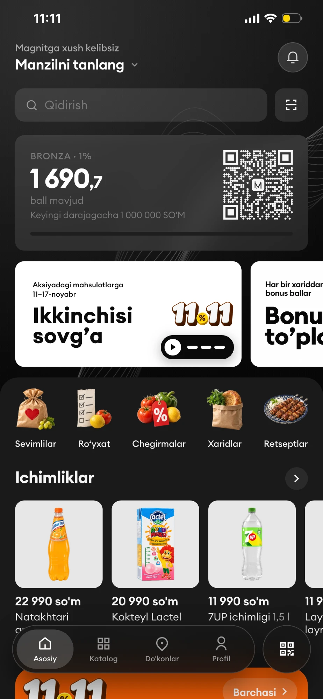
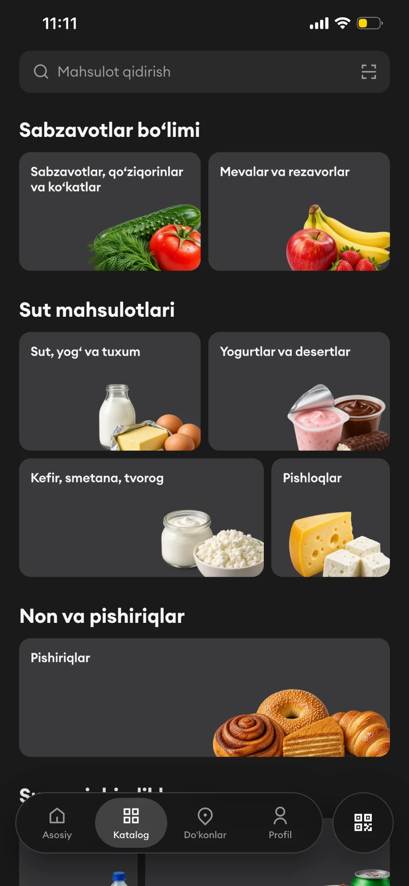
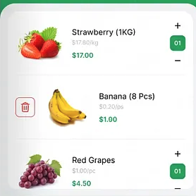

# Magnit Go: redesign plan

Unofficial concept. What the next round of work is, with the references it is built from.

## Rules for this round

- **Palette stays:** graphite background, cream receipt paper, off-white buttons, orange only for earned cashback.
- **The cheque stays.** The cream receipt (basket, QR at the till, paid receipt) is kept as it is.
- **Richer, not barer.** Photos, a product window and a welcome flow. No stripped-down screens.
- **Understandable first.** Every number is labelled, every screen says what happens next, choices stay visible.
- **Icons:** Untitled UI PRO, solid set only.
- **Type:** no monospaced type outside the cheque.

## References

### Brand

| | |
|---|---|
|  | The black-and-cream Magnit mark. Cream `#CEC7B3` and ink `#05020D` are sampled from it. |

### Magnit's current app (structure and tone)

| Home | Catalogue | Stores | Profile |
|---|---|---|---|
|  |  |  |  |

Taken from it: dark surfaces, the loyalty card with level and progress, the store picker at the top of home.

### Basket rows with product photos

Taken from it: a cut-out photo on every row, the name with its unit, the price, quantity controls on the row, a remove button.

### Product window

Reference image was pasted in chat and is not saved as a file. It shows a "Product Details" screen: round back button and basket button with a count in the top bar, a large product photo on a curved white sheet, name and weight, a large price, a short description with "read more", and at the bottom a quantity stepper next to a wide "Add to cart" button.

Taken from it: the whole layout. Left out: the star rating and "fast delivery" badge, because the app has no ratings and no delivery.

### Welcome screen

Reference image was pasted in chat and is not saved as a file. It shows a rounded store photo of a shopper with a trolley, a large headline ("Fresh food for Everyday"), a coloured lower panel with one line of copy, three page dots, and one wide "Let's Shop" button with an arrow.

Taken from it: photo, headline, lower panel, page dots, one button.

## Work

| # | What | Status |
|---|---|---|
| 1 | Scan barcodes, scale labels and Data Matrix marking codes | Done |
| 2 | QR at the till carries the real basket (`MagnitGo/Core/BasketQR.swift`) | Done |
| 3 | UX-laws audit fixes: boxed sign-in fields, points before the QR, scan beep and confirmation, newest-first basket, store picker | Done |
| 4 | Untitled UI PRO solid icons everywhere | Done |
| 5 | Product photos: 12 cut-outs in `Assets.xcassets/Products` (sources in `reference/photo-credits.md`) | Photos added, not yet shown in the app |
| 6 | Product descriptions and photo names in the catalogue | Data added, not yet shown in the app |
| 7 | Photo on every basket and scanner row | Next |
| 8 | Product window for each product, opened from a basket row | Next |
| 9 | "Bought before" row of products on home | Next |
| 10 | Welcome screens before sign-in: 3 pages, photos in `Assets.xcassets/Welcome` | Photos added, screens next |
| 11 | Rounded type and pill buttons outside the cheque | Next |
| 12 | Check every changed screen in the simulator, then on the iPhone | After 7–11 |

## Not verified yet

- Reading real marking codes off a bottle with the phone camera.
- The scan beep (chosen by name, never heard).
- Russian on the screens changed since the last check.
