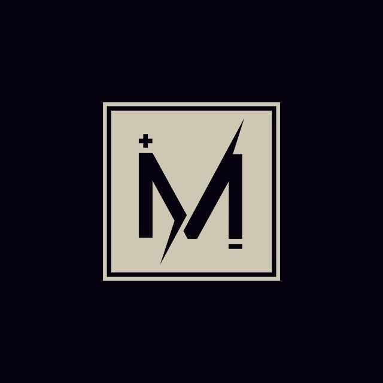
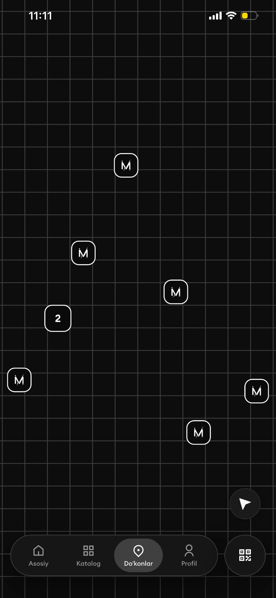
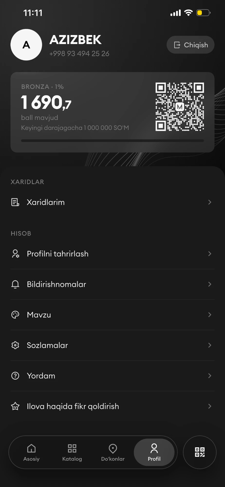

# Magnit Go: redesign plan

Unofficial concept. What the next round of work is, with the references it is built from.

## Rules for this round

- **Palette stays:** graphite background, cream receipt paper, off-white buttons, orange only for earned cashback.
- **The cheque stays.** The cream receipt (basket, QR at the till, paid receipt) is kept as it is.
- **Richer, not barer.** Photos, a product window and a welcome flow. No stripped-down screens.
- **Understandable first.** Every number is labelled, every screen says what happens next, choices stay visible.
- **Icons:** Untitled UI PRO, solid set only.
- **Type:** no monospaced type outside the cheque.

## References

### Brand

| | |
|---|---|
|  | The black-and-cream Magnit mark. Cream `#CEC7B3` and ink `#05020D` are sampled from it. |

### Magnit's current app (structure and tone)

| Home | Catalogue | Stores | Profile |
|---|---|---|---|
|  |  |  |  |

Taken from it: dark surfaces, the loyalty card with level and progress, the store picker at the top of home.

### Basket rows with product photos

Taken from it: a cut-out photo on every row, the name with its unit, the price, quantity controls on the row, a remove button.

### Product window

Reference image was pasted in chat and is not saved as a file. It shows a "Product Details" screen: round back button and basket button with a count in the top bar, a large product photo on a curved white sheet, name and weight, a large price, a short description with "read more", and at the bottom a quantity stepper next to a wide "Add to cart" button.

Taken from it: the whole layout. Left out: the star rating and "fast delivery" badge, because the app has no ratings and no delivery.

### Welcome screen

Reference image was pasted in chat and is not saved as a file. It shows a rounded store photo of a shopper with a trolley, a large headline ("Fresh food for Everyday"), a coloured lower panel with one line of copy, three page dots, and one wide "Let's Shop" button with an arrow.

Taken from it: photo, headline, lower panel, page dots, one button.

## Work

| # | What | Status |
|---|---|---|
| 1 | Scan barcodes, scale labels and Data Matrix marking codes | Done |
| 2 | QR at the till carries the real basket (`MagnitGo/Entities/Basket/BasketQR.swift`) | Done |
| 3 | UX-laws audit fixes: boxed sign-in fields, points before the QR, scan beep and confirmation, newest-first basket, store picker | Done |
| 4 | Untitled UI PRO solid icons everywhere | Done |
| 5 | Product photos: 12 cut-outs in `Assets.xcassets/Products` (sources in `reference/photo-credits.md`), shown through `ProductPhoto` | Written, not built yet |
| 6 | Product descriptions and photo names in the catalogue | Shown in the product window |
| 7 | Photo on every basket and scanner row (`EditableLine`) | Written, not built yet |
| 8 | Product window (`App/Pages/Product/ProductScreen.swift`), opened from a basket row's photo or name | Written, not built yet |
| 9 | "Bought before" row of products on home, opens the product window | Written, not built yet |
| 10 | Welcome screens before sign-in (`App/Pages/Welcome/WelcomeView.swift`): 3 pages, shown once | Written, not built yet |
| 11 | Rounded type (`Font.ui`) and pill buttons outside the cheque; `Font.paper` keeps the cheque's face | Written, not built yet |
| 12 | Pack details in the product window: calories, protein, fat, carbs per 100 g (100 ml for drinks), ingredients, shelf life, country (`Catalog.facts`, demo values) | Written, not built yet |
| 13 | Scan opens the product window and asks to add (`Features/ScanProduct`, `Features/AddToBasket`) | Written, not built yet |
| 14 | Code moved into feature-driven layers (`ARCHITECTURE.md`, `scripts/check-layers.sh`) | Written, not built yet |
| 15 | Build, then check every changed screen in the simulator, then on the iPhone | Next, on a Mac |

## Decisions in this round

- **Photos only on the editable basket.** Basket rows and the scanner slip show a photo. The QR screen and paid receipts stay text-only, so the cheque that is shown and kept is unchanged.
- **A scan opens the product window and asks before adding.** Nothing is added automatically: the window shows what was read (quantity picker for piece goods; weight from the scale label; one bottle per marking code), the price, "Add to basket" and "Don't add". From the basket, the window edits that line with the cheque's own rules. From home, there is no add button: nothing reaches the basket without a scan, so it offers "Start scanning".
- **Pack details are typical values, not read off real packs.** Manufacturer is left empty rather than invented; the screen shows it once the price list supplies it.
- **Welcome button arrow** uses `chevron-right` until an arrow-right icon is exported from the Untitled UI PRO package.

## How to check

- `-resetState` shows the welcome pages, then sign-in.
- In the simulator, tap a demo product on the scanner: its window opens and asks to add it.
- `-demoBasket` with "Start scanning" fills a basket; open it and tap a line's name for the product window.
- Home shows "Bought before" from the seeded history; tap a card.

## Not verified yet

- Reading real marking codes off a bottle with the phone camera.
- The scan beep (chosen by name, never heard).
- Russian on the screens changed since the last check, including the welcome pages and the product window.
- Anything from items 5–14: this round was written without a compiler.
